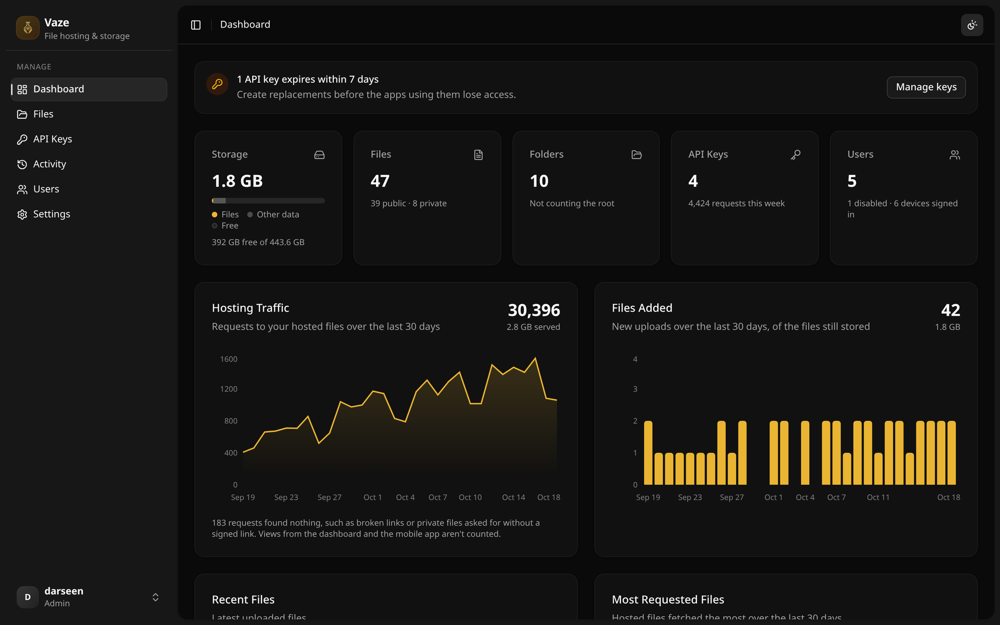
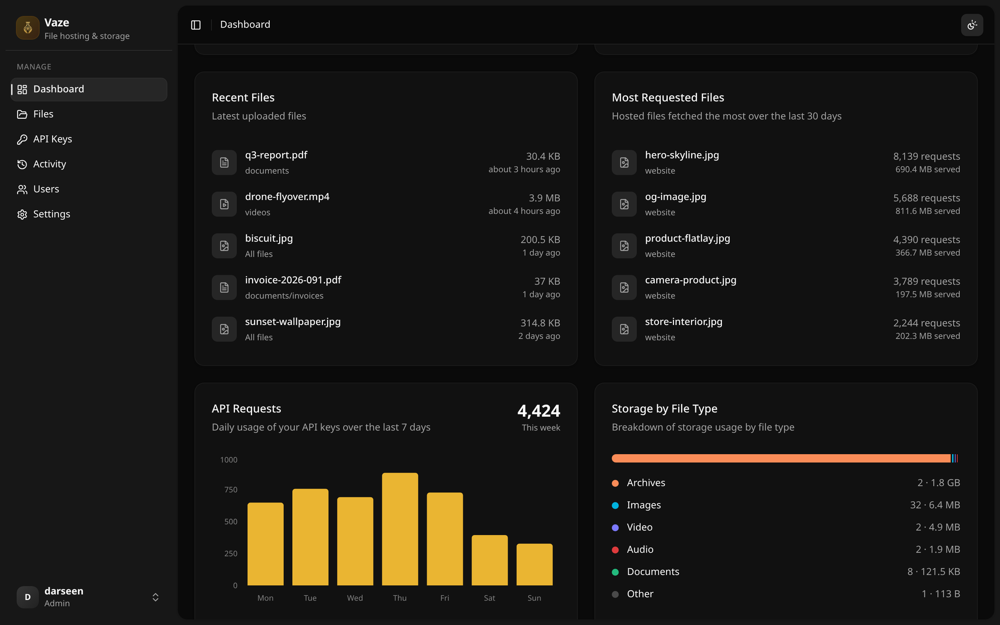
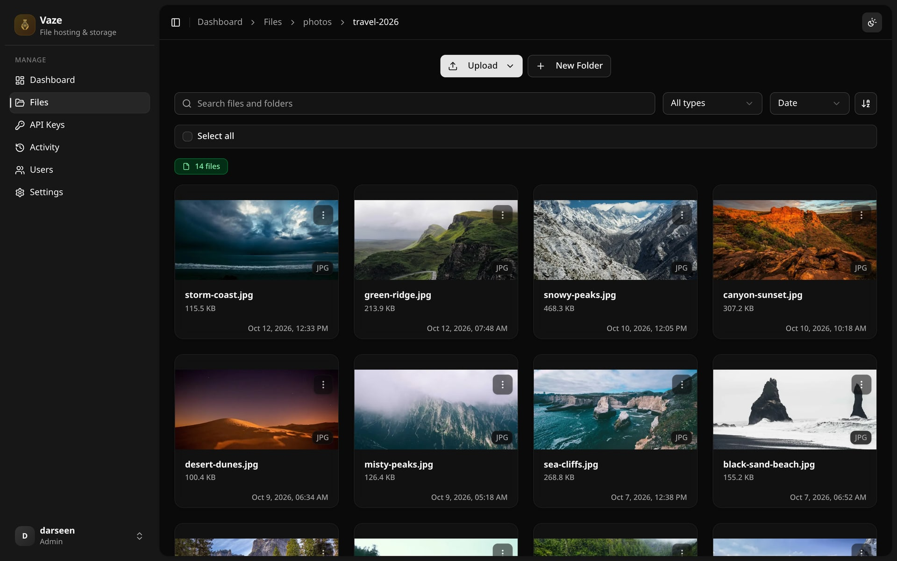
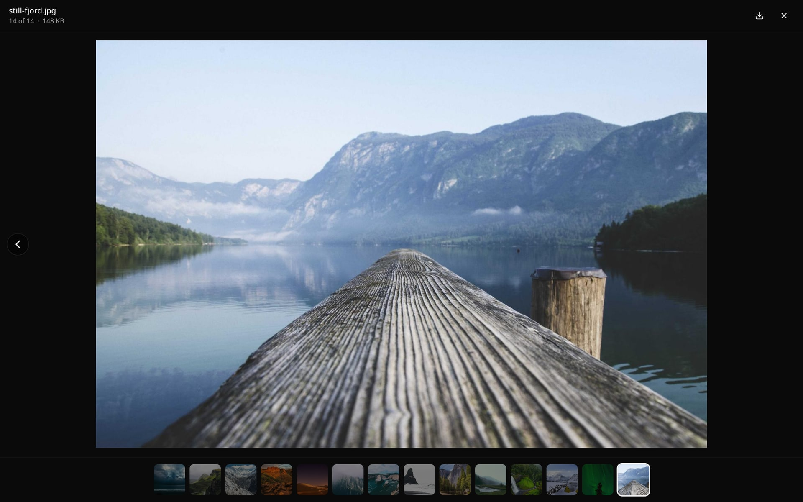
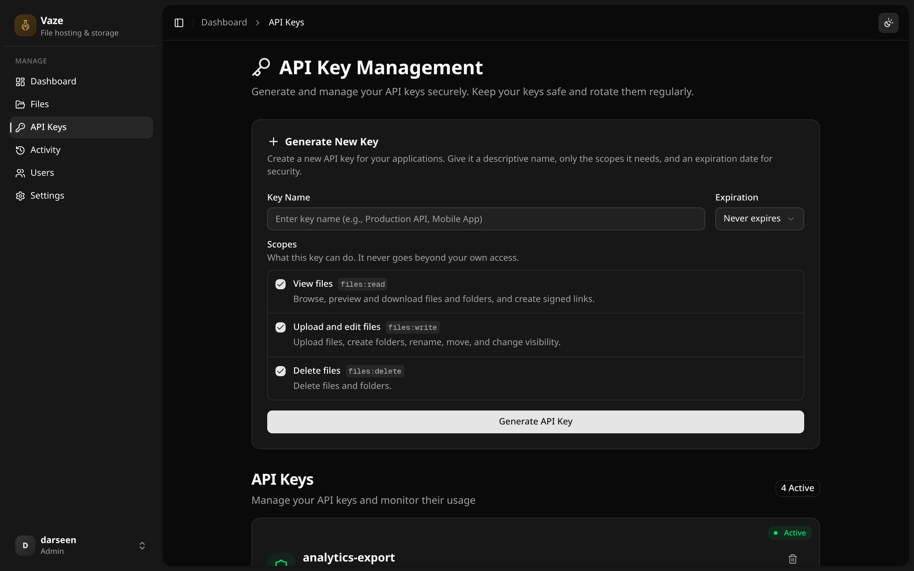
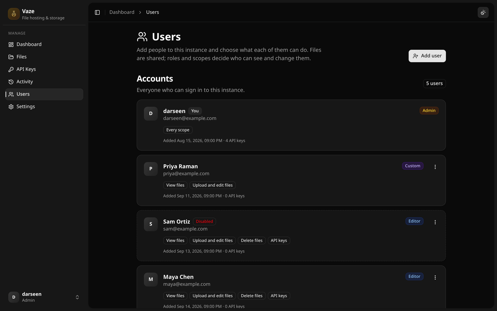
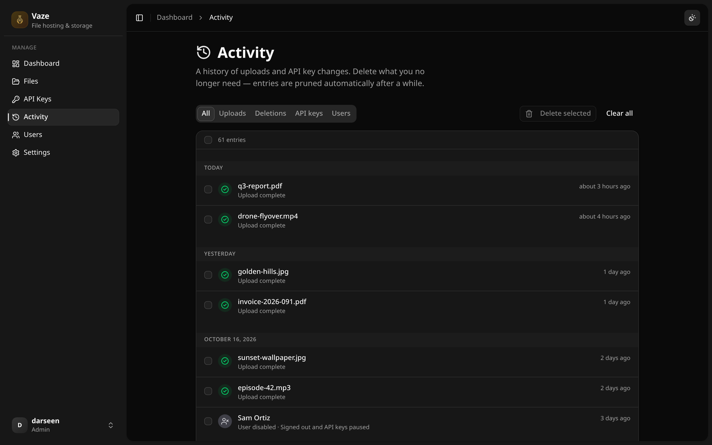
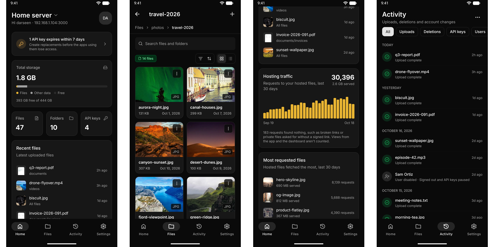
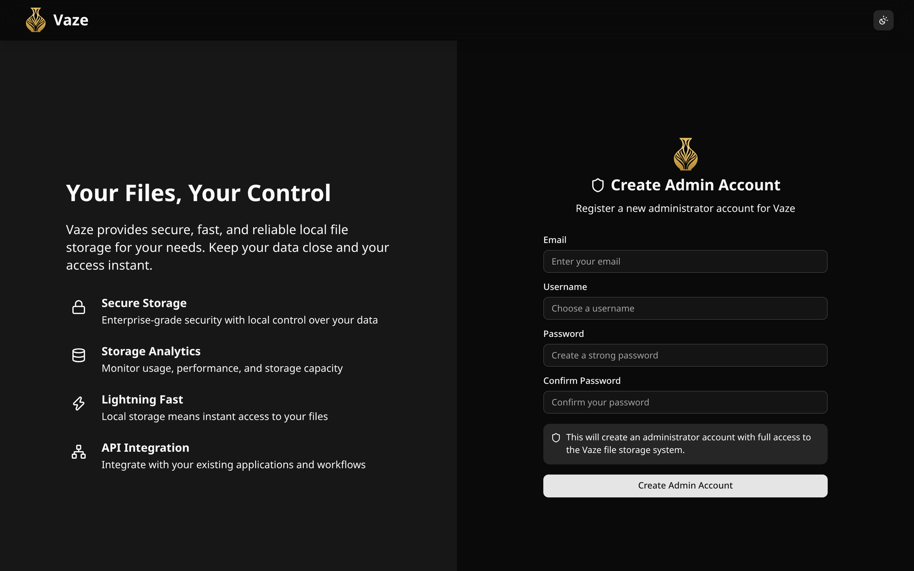

# Vaze | Local File Storage & Hosting

 
 

**[Website](https://vaze.darseen.dev)** &nbsp;|&nbsp; **[Documentation](https://vaze.darseen.dev/docs)**

**Vaze** is a self-hosted file storage and hosting service that runs as a single Docker container on your own server or home network. Manage your files from the web dashboard or the Android app, host them at URLs you choose, and use its API as a file backend for your other apps. Installation, configuration, the API reference and the SDK guide are all in the **[documentation](https://vaze.darseen.dev/docs)**, starting with **[installation](https://vaze.darseen.dev/docs/getting-started/installation)**.

## Features

- **Files and folders**: Upload whole folders, browse with thumbnails and a viewer, and download, move or delete many files at once. Uploads stream straight to disk, so size is limited only by your volume.
- **Hosting at URLs you choose**: Files keep the names you upload them with, so a link like `/api/hosting/projects/demo/photo.png` stays the same. Audio and video seek properly, and repeat requests are cached.
- **Private files and signed links**: Make any file or folder private, then share it with a link that expires.
- **Users, roles and API keys**: Add accounts as Admin, Editor or Viewer, or with a custom set of scopes, and give each API key only the access it needs.
- **Dashboard**: See what needs attention, how your storage is used, hosting traffic, the most requested files and how each API key is used.
- **Android app**: The same files, dashboard, keys and users on your phone, for as many servers as you add.
- **API and SDK**: A REST API and the [`@darseen/vaze`](https://npmjs.com/package/@darseen/vaze) TypeScript SDK for using Vaze from your own apps.
- **Docker**: One container and one data volume. A single command installs it and later upgrades it.

## Screenshots

  <h3> Dashboard </h3>
  
  

  <h3> Files </h3>
  

  <h3> File Viewer </h3>
  

  <h3> API Keys </h3>
  

  <h3> Users </h3>
  

  <h3> Activity </h3>
  

  <h3> Android App </h3>
  

  <h3> Registration </h3>
  

## License

Vaze is released under the [MIT License](./LICENSE). Contributions are welcome: fork the repository and open a pull request.
