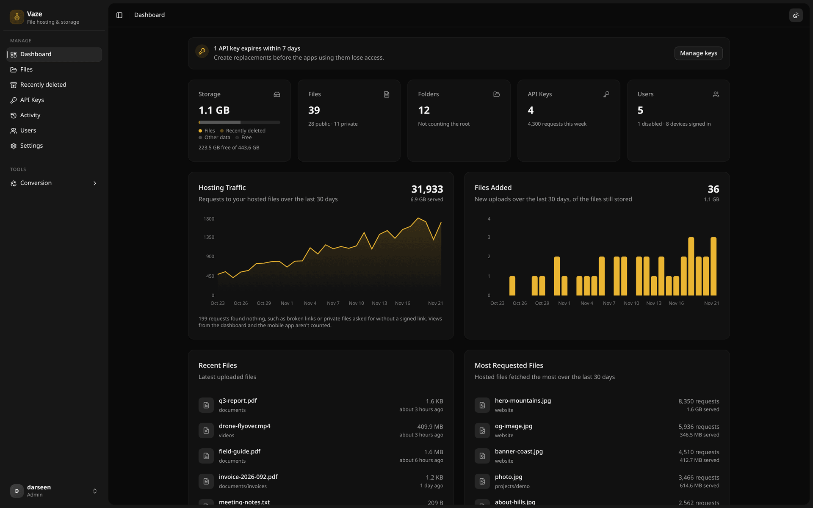
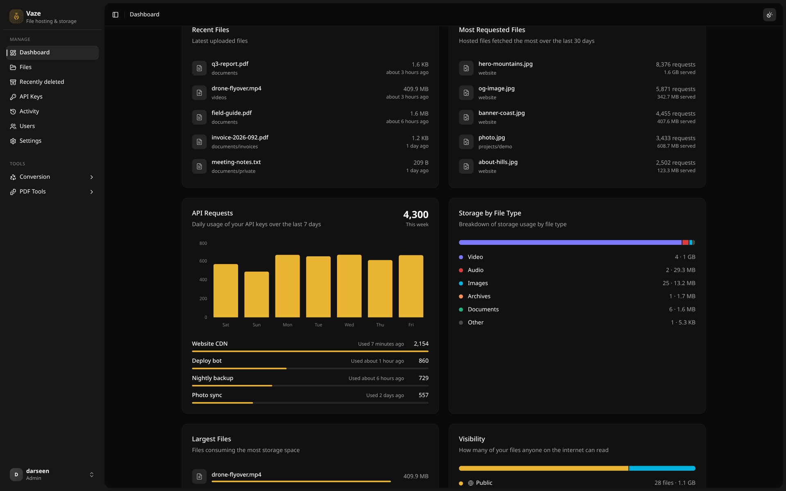
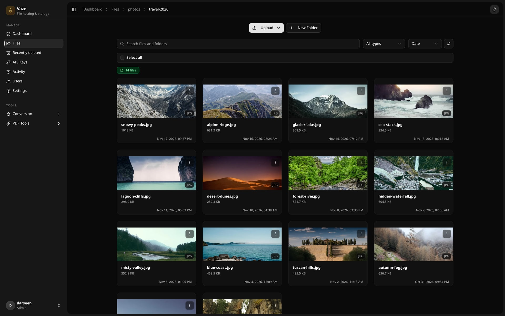
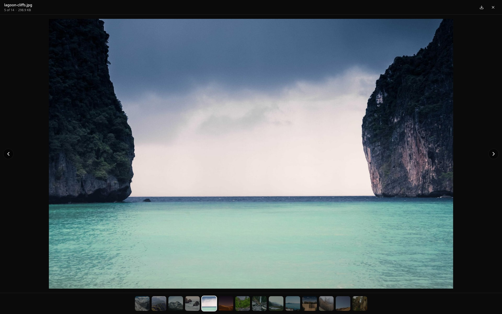
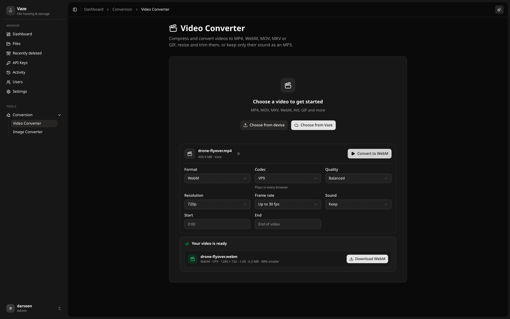
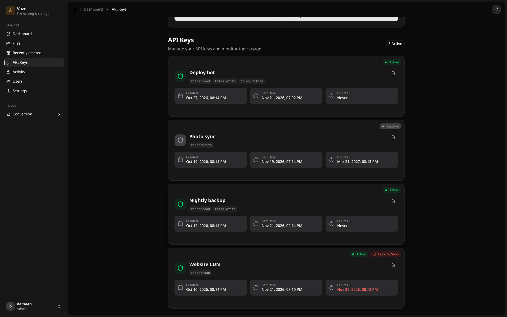
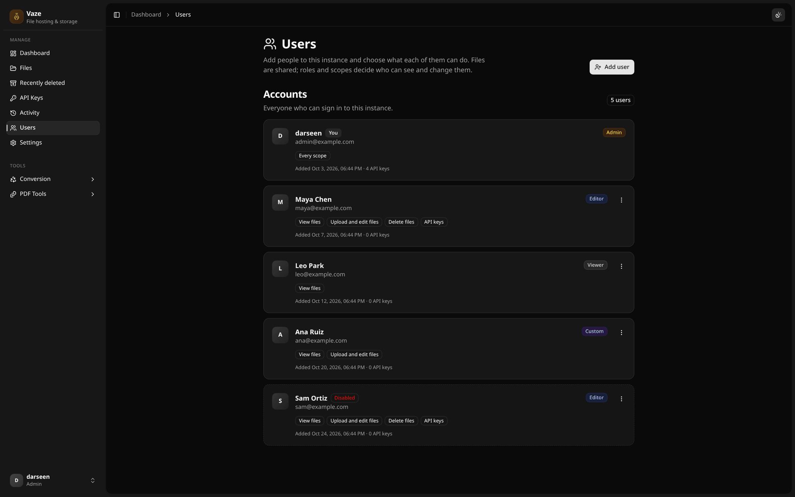
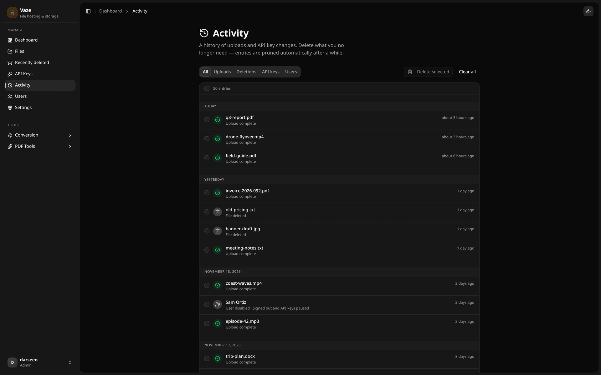
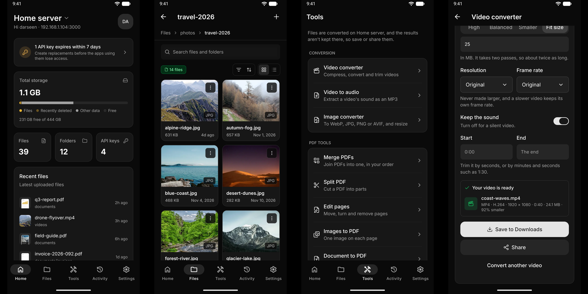
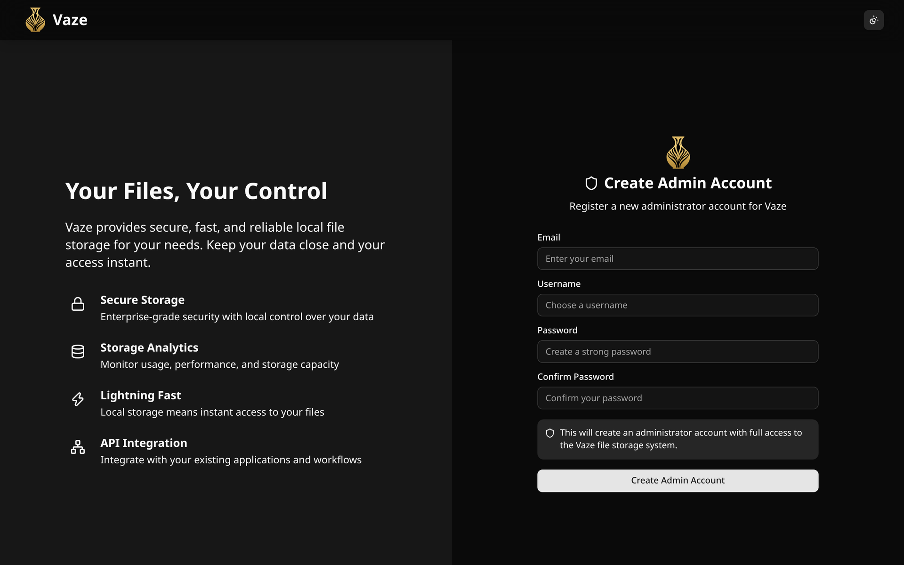

# Vaze | Local File Storage & Hosting

 
 

**[Website](https://vaze.darseen.dev)** &nbsp;|&nbsp; **[Documentation](https://vaze.darseen.dev/docs)**

**Vaze** is a self-hosted file storage and hosting service that runs as a single Docker container on your own server or home network. Manage your files from the web dashboard or the Android app, host them at URLs you choose, convert videos and images without them leaving your server, and use its API as a file backend for your other apps. Installation, configuration, the API reference and the SDK guide are all in the **[documentation](https://vaze.darseen.dev/docs)**, starting with **[installation](https://vaze.darseen.dev/docs/getting-started/installation)**.

## Features

- **Files and folders**: Upload whole folders, browse them with thumbnails, search and filter, and open images, video, audio, PDFs and text in a full-screen viewer. Move, download or delete many files at once, and restore mistakes from Recently deleted. Uploads stream straight to disk, so size is limited only by your volume.
- **Hosting at URLs you choose**: Files keep the names you upload them with, so a link like `/api/hosting/projects/demo/photo.jpg` stays the same. Video and audio seek, repeat requests are cached, and images can be resized on the fly.
- **Private files and signed links**: Make any file or folder private, then share it with a link that expires.
- **Video and image conversion**: Compress and convert videos to MP4, WebM, MOV, MKV or GIF, resize, trim or mute them, or keep only their sound as an MP3. Turn HEIC photos and other images into WebP, JPG, PNG or AVIF.
- **Users, roles and API keys**: Add accounts as Admin, Editor or Viewer, or with a custom set of scopes, and give each API key only the access it needs.
- **Dashboard and activity**: See what needs attention, how your storage is used, hosting traffic, the most requested files and how each API key is used, with a history of sign-ins, uploads, deletions and account changes.
- **Android app**: The same files, tools, dashboard, keys and users on your phone, for as many servers as you add.
- **API and SDK**: A REST API and the [`@darseen/vaze`](https://npmjs.com/package/@darseen/vaze) TypeScript SDK for using Vaze from your own apps.
- **Docker**: One container and one data volume, with everything the tools need already inside. A single command installs it and later upgrades it.

## Benchmarks

Vaze and Seafile 14, a long-established self-hosted file server, ran sixteen everyday file operations on the same machine. Vaze was faster in all sixteen, from 1.4× to 33× depending on the operation: it zipped a 500 MiB photo album 16× faster, renamed, moved and deleted files 16× to 33× faster, and served 2,000 public downloads 3.6× faster. It also needed 56 MB of memory after a fresh start, against 489 MB for Seafile with its database and cache. The **[benchmarks page](https://vaze.darseen.dev/benchmarks)** has every result and how it was measured.

## Screenshots

  <h3> Dashboard </h3>
  
  

  <h3> Files </h3>
  

  <h3> File Viewer </h3>
  

  <h3> Video Converter </h3>
  

  <h3> API Keys </h3>
  

  <h3> Users </h3>
  

  <h3> Activity </h3>
  

  <h3> Android App </h3>
  

  <h3> Registration </h3>
  

## License

Vaze is released under the [MIT License](./LICENSE). Contributions are welcome: fork the repository and open a pull request.
